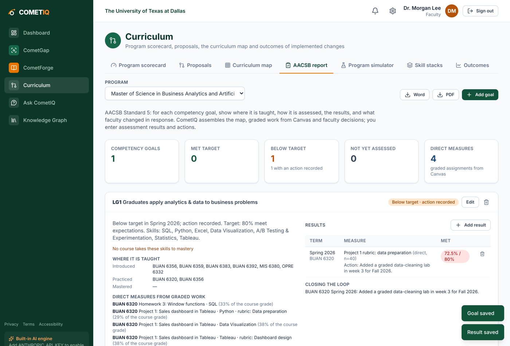

# AACSB assurance-of-learning report

**Curriculum → AACSB report** builds the evidence AACSB's 2020 Standard 5 (Assurance of Learning) asks for, one program at a time. It uses data CometIQ already has. Faculty add only the two things no system can infer: the program's **competency goals** and the **assessment results**.

## What each goal shows

| Section | Where it comes from |
|---|---|
| **Where it is taught** | The program's curriculum map: the courses that introduce, practice or master the goal's skills, from faculty map entries and faculty-reviewed syllabi. |
| **Direct measures** | Graded Canvas assignments and rubric criteria in program courses that practice the goal's skills, with each one's share of the course grade. |
| **Results** | Faculty-entered results per term: the measure (direct or indirect), the number of students assessed, the % meeting expectations, and the target. |
| **Closing the loop** | Actions recorded with results, faculty decisions on gaps in these skills, and approved or adopted curriculum proposals for these courses. |
| **Status** | The latest term decides: met target, below target with an action recorded, or below target with no action yet. Without results, the goal is "not yet assessed" (or "not practiced in any course"). |

**Warnings:** a goal is flagged when the curriculum map shows no course practicing its skills, or no course taking them to mastery.

## Workflow

1. **Set the goals.** Choose the program. Start from the suggested goals (the program's in-demand skills, grouped by area) or write your own: a code (LG1), the goal, its skills, and a target % (default 80).
2. **Add results** after each assessment cycle. The measure field suggests the graded work CometIQ found in Canvas. When a result is below target, record the action taken; that is the closing-the-loop evidence reviewers look for.
3. **Export** the report as **Word** (to edit into the school's continuous-improvement review) or **PDF**.

## Notes

- **Who can edit:** faculty and admins edit goals and results. Every change is recorded in the audit log.
- **Student data:** results are aggregate counts. CometIQ stores no individual student scores for assurance of learning.
- **Validation:** a result can't have more students meeting expectations than were assessed (enforced by the database too), and the target is 1–100%.
