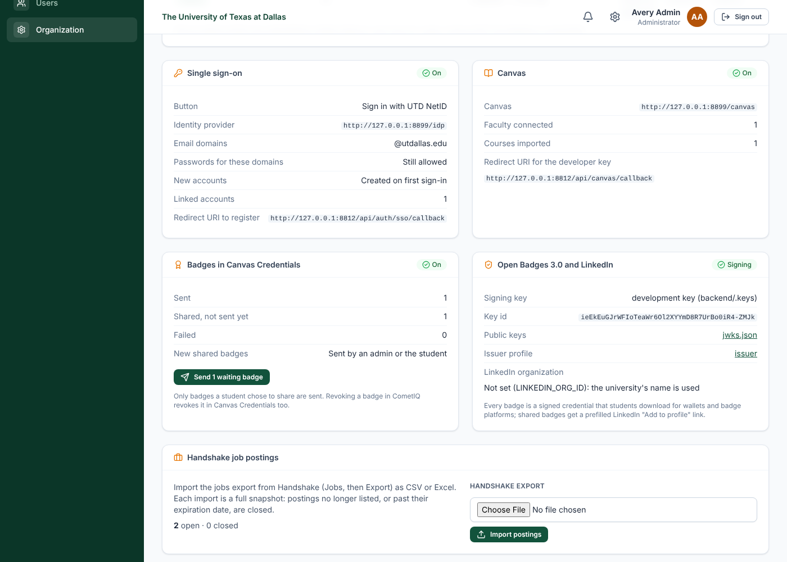
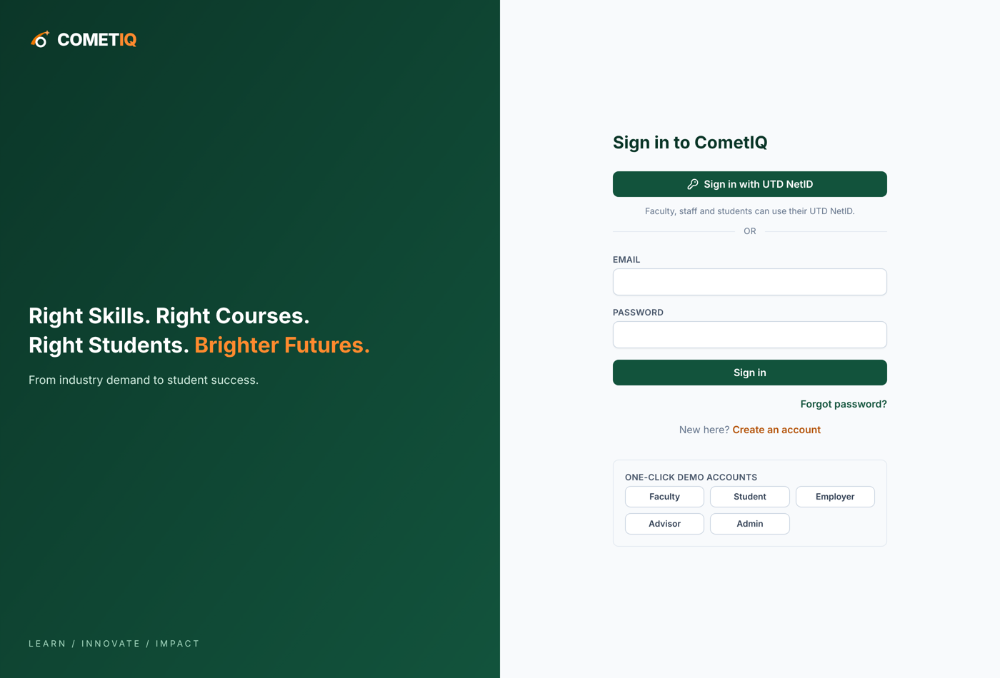
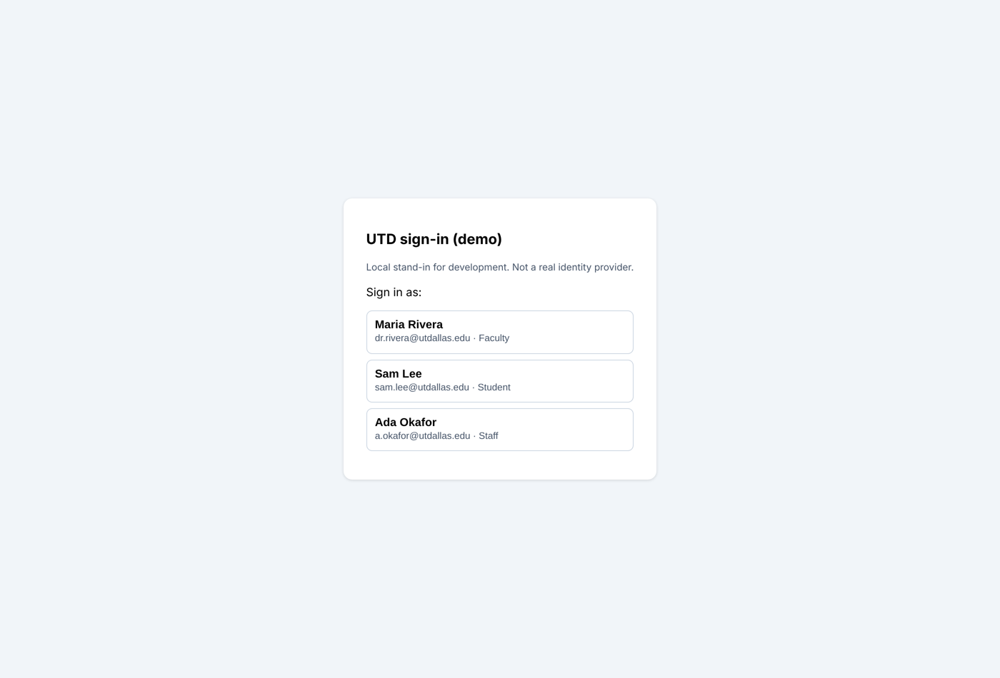
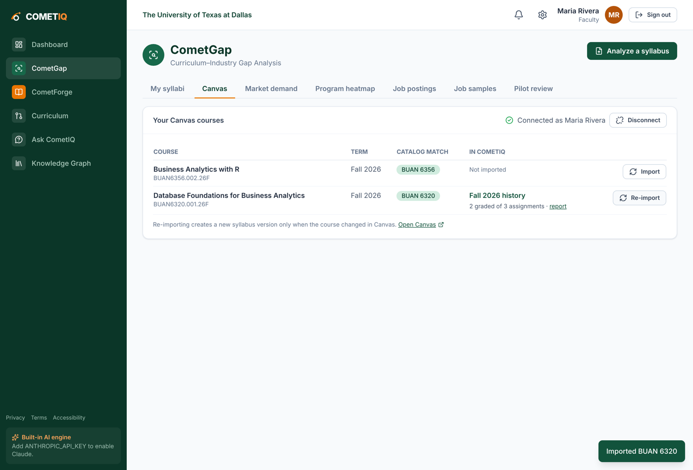
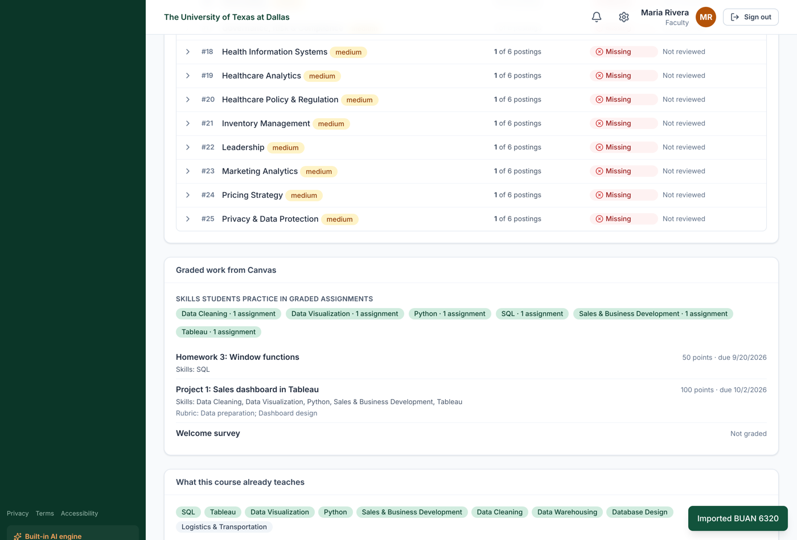
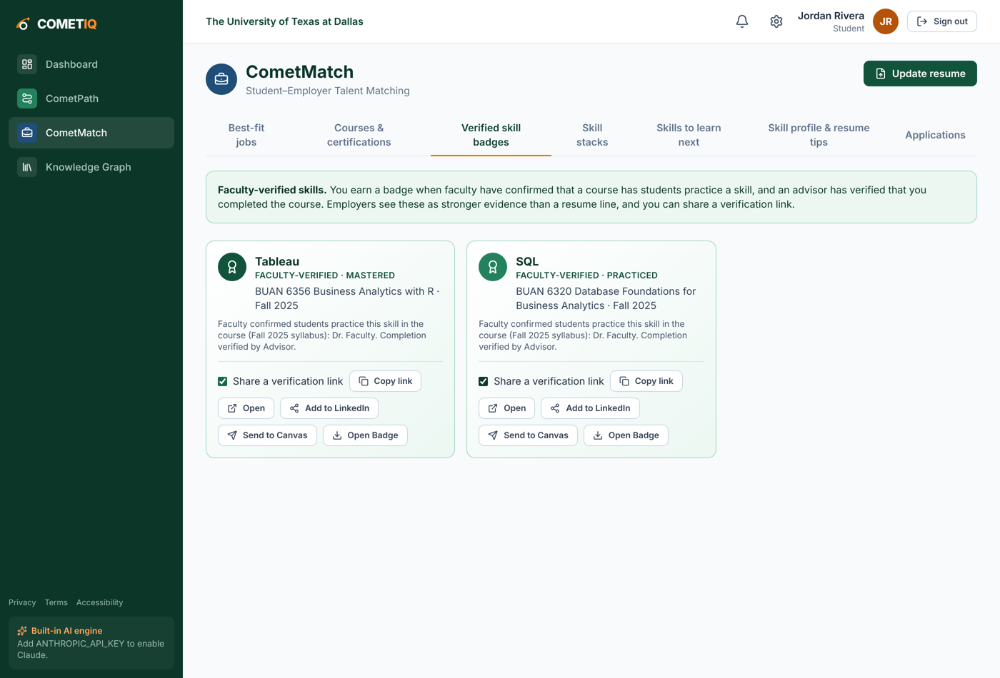
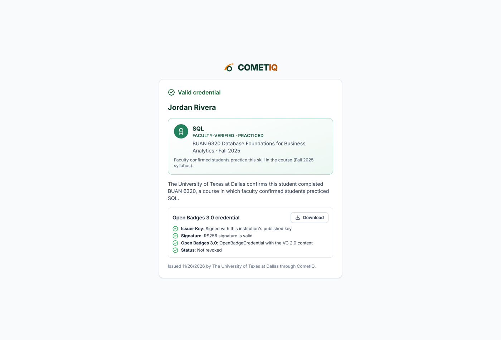

# Connecting CometIQ to the university's systems

Five integrations. Each is off until it is configured, and each can be set up on its own:

| Integration | What it does | Who sets it up |
|---|---|---|
| [Single sign-on](#1-single-sign-on-netid) | Sign in with the UTD NetID. Accounts are created on first sign-in. | Identity and access management (IT) |
| [Canvas](#2-canvas) | Faculty import a course's syllabus page and graded assignments, with rubrics. | Canvas administrators |
| [Canvas Credentials](#3-canvas-credentials-badges-in-canvas) | Faculty-verified badges appear in students' Canvas Backpack. | Canvas Credentials issuer admin |
| [Open Badges 3.0 and LinkedIn](#4-open-badges-30-and-linkedin) | Every badge is a signed, verifiable credential with an "Add to LinkedIn" link. | CometIQ operator (a signing key) |
| [Handshake](#5-handshake) | The career center's postings feed the job market that CometIQ analyzes. | Career center |

All settings are environment variables on the server; see `.env.example`. The admin page **Organization → Integrations** shows what is configured, the redirect URIs to register, and how much each integration is used.



To try every flow without real credentials, run the local stand-ins in `backend/scripts/fake_institution.py`. They provide an identity provider, Canvas and Canvas Credentials. The script's docstring lists the settings to use. These stand-ins are for development only.

---

## 1. Single sign-on (NetID)

CometIQ uses **OpenID Connect**: the authorization code flow with PKCE, and RS256-signed ID tokens checked against the provider's published keys. This works with:

- **Microsoft Entra ID**, which holds UTD's Microsoft 365 accounts;
- a **Shibboleth IdP** with the OIDC plugin.

SAML-only providers are not supported yet.

**IT registers CometIQ as an application.** For Microsoft Entra ID, this is an app registration:

1. **Platform:** Web. **Redirect URI:** `https://<cometiq-host>/api/auth/sso/callback`. The exact value is shown on the admin page.
2. **Credentials:** create a client secret. Give it to the CometIQ operator through your secrets process, not by email or chat.
3. **Token claims:** add the optional claims `email` and `preferred_username`.
4. **Roles:** CometIQ needs a claim that tells faculty, staff and students apart. Use one of these:
   - **App roles** (recommended): define `Faculty`, `Staff` and `Student`, and assign groups to them. They arrive in the `roles` claim.
   - **A group or affiliation claim:** for example eduPersonAffiliation from Shibboleth. Set `SSO_ROLE_CLAIM` to its name.

**CometIQ settings:**

```
SSO_ENABLED=true
SSO_PROVIDER_NAME=UTD NetID
SSO_ISSUER=https://login.microsoftonline.com/<tenant-id>/v2.0
SSO_CLIENT_ID=<application id>
SSO_CLIENT_SECRET=<secret>
SSO_ALLOWED_DOMAINS=utdallas.edu
SSO_ROLE_CLAIM=roles
SSO_ROLE_MAP=faculty:faculty,staff:advisor,student:student
SSO_DEFAULT_ROLE=student
SSO_REQUIRED=false
```

`SSO_ROLE_MAP` maps claim values to CometIQ roles; letter case doesn't matter. Set `SSO_REQUIRED=true` once single sign-on works for everyone.

**How it behaves:**

- **Account matching.** A person is matched first by the provider's stable subject id, then by institutional email. That links accounts created earlier with a password.
- **New accounts.** New people get an account on first sign-in, with a role from the claim. Set `SSO_AUTO_PROVISION=false` to allow existing accounts only. Admin roles are never granted by single sign-on.
- **Existing roles.** Single sign-on never changes an existing account's role. Admins manage roles in CometIQ.
- **Required SSO.** With `SSO_REQUIRED=true`, institutional emails can no longer use a password or self-register. Other domains, such as employers, still can. So can the bootstrap admin, as a break-glass account.
- **Session token.** The CometIQ session token reaches the browser in the URL fragment. Browsers never send the fragment to servers, so it stays out of proxy and access logs.
- **Pilot roles.** Pilot role limits (`PILOT_ROLES`) apply to single sign-on as well.
- **Privacy.** Accounts created by single sign-on accept the privacy notice on their first visit. They have no CometIQ password, so deleting the account needs only the typed confirmation.

| Sign-in page | The provider (local stand-in) |
|---|---|
|  |  |

## 2. Canvas

Each faculty member connects their Canvas account once. After that, **CometGap → Canvas** lists the courses they teach. **Import** reads:

- the course's **syllabus page**;
- its **published assignments**: instructions, points, due dates and **rubrics**.

CometIQ builds one document from these. Graded assignments are listed under "Graded assignments", so skills practiced in graded work count in the gap analysis, and the report shows which assignment practices which skill. Ungraded and unpublished items are skipped.

The import maps the Canvas course code (for example `BUAN6320.001.26F`) to the catalog course and the Canvas term to a semester. Re-importing creates a **new syllabus version only when something changed**, so semester comparisons keep working.

**Canvas administrators create a developer key** (Admin → Developer Keys → API key):

1. **Redirect URI:** `https://<cometiq-host>/api/canvas/callback`.
2. **Scopes:** enforce scopes if your policy requires it. CometIQ only reads:
   - `url:GET|/api/v1/courses`
   - `url:GET|/api/v1/courses/:id`
   - `url:GET|/api/v1/courses/:course_id/assignments`

   If you enforce scopes, list the same three, separated by spaces, in `CANVAS_SCOPES`.
3. Turn the key **On** and give CometIQ the client id and secret.

```
CANVAS_BASE_URL=https://<school>.instructure.com
CANVAS_CLIENT_ID=<developer key id>
CANVAS_CLIENT_SECRET=<developer key>
SECRETS_KEY=<32+ random characters>
```

`SECRETS_KEY` encrypts the stored Canvas tokens. Keep it stable.

**Tokens:**
- Canvas access and refresh tokens are stored **encrypted** and refreshed automatically.
- Disconnecting revokes the token at Canvas.
- Deleting the CometIQ account removes the connection.
- The tokens are never included in data exports.

| Canvas courses in CometGap | Graded work on the report |
|---|---|
|  |  |

## 3. Canvas Credentials (badges in Canvas)

Faculty-verified badges can be sent to **Canvas Credentials** (formerly Badgr), Instructure's badge platform. Students then see them in their Canvas Backpack.

**How sending works:**
- **What is sent:** only badges a student chose to **share**. Each is addressed to the student's hashed email.
- **Who sends them:** the student ("Send to Canvas") or an admin ("Send waiting badges"). With `CREDENTIALS_AUTO_SEND=true`, a badge is sent as soon as the student shares it.
- **Badge classes:** CometIQ creates one badge class per skill and level, and reuses it for every student.
- **Revoking:** revoking a badge in CometIQ, or deleting the student's account, revokes it in Canvas Credentials too.
- **Failures:** they are recorded on the badge and shown to the student and the admin.

```
CREDENTIALS_BASE_URL=https://api.badgr.io
CREDENTIALS_TOKEN=<API token of an issuer staff account>
CREDENTIALS_ISSUER_ID=<the university issuer's entity id>
CREDENTIALS_AUTO_SEND=false
```

`CREDENTIALS_BASE_URL` depends on your region's Canvas Credentials server.

## 4. Open Badges 3.0 and LinkedIn

Every faculty-verified badge is also an **Open Badges 3.0** `OpenBadgeCredential`, a W3C Verifiable Credential 2.0. It is signed as a **VC-JWT** (RS256). Students can download it from their badge for digital wallets and badge platforms.

**What gets published:**

| Item | Address |
|---|---|
| The institution's public keys | `/api/public/ob/jwks.json` |
| The issuer profile | `/api/public/ob/issuers/<org-id>` |
| Each achievement | `/api/public/ob/achievements/<org>/<skill>/<level>` |
| A shared badge's credential | `/api/public/ob/credentials/<token>` |

**Verification:** `POST /api/public/ob/verify` checks a credential's signature, format and current status. A revoked badge fails at once. The public badge page runs these checks for anyone who opens it.

**What a credential contains:**
- **Subject:** a salted SHA-256 hash of the student's email, as the standard recommends. There is no plain email or name in the subject.
- **Evidence:** the course, the term, the faculty confirmation and the completion verification.

**LinkedIn:** a shared badge offers **Add to LinkedIn**. It opens LinkedIn's "Add license or certification" form, prefilled with the name, issuer, issue date, the verification URL and the credential id. No LinkedIn API access is needed. Set `LINKEDIN_ORG_ID` to the university's LinkedIn organization id so the certification links to the university's LinkedIn page.

**Signing key.** In production, create one RSA key and keep it in your secrets store:

```bash
openssl genpkey -algorithm RSA -pkeyopt rsa_keygen_bits:3072 -out ob_signing_key.pem
```

Then set `OB_SIGNING_KEY` to the PEM text, or set `OB_SIGNING_KEY_FILE` to its path. Development generates a key in `backend/.keys/`, which is git-ignored.

If you rotate the key, credentials issued earlier no longer verify. Plan a rotation as a re-issue.

| Student badges | Public verification |
|---|---|
|  |  |

## 5. Handshake

Handshake does not offer an open jobs API. CometIQ instead reads the **jobs export** that career-center staff can download from Handshake.

**Two ways to get it in:**
- **Upload:** an admin uploads it (CSV, Excel or JSON) on the Integrations page.
- **Nightly pull:** the same export is served from a URL (`HANDSHAKE_FEED_URL`, with an optional `HANDSHAKE_FEED_TOKEN`). The nightly job sync pulls it, for example from a scheduled export that IT publishes internally.

**Columns** are matched by name, ignoring case and punctuation:

| Required | Optional |
|---|---|
| Job ID, Job Title | Employer, Location(s), Job Type, Description, Posted Date, Expiration Date, URL |

Rows without an id or a title are skipped and reported. Postings without a URL link to Handshake (`HANDSHAKE_JOB_URL`).

**Each import is a snapshot.** It does four things:
- adds new postings;
- updates changed postings and re-extracts their skills;
- reopens postings that are back in the export;
- closes postings that are missing or past their expiration date.

Handshake postings belong to the institution: they appear in students' matches and in the job market that faculty compare syllabi against.

---

## Testing

`backend/tests/test_institution.py` runs every integration against in-process fakes of the real services. There are 22 tests:

- **Single sign-on:**
  - first sign-in creates the account;
  - accounts are matched by subject and linked by email;
  - roles come from the claim;
  - each rejection case fails: state, nonce, audience, expiry, forged signature, unknown key, wrong domain;
  - required-SSO behaves as described;
  - account deletion works without a password.
- **Canvas:**
  - the OAuth flow, including a forged state;
  - pagination;
  - encrypted tokens and token refresh;
  - the import, with graded and ungraded assignments, rubrics and unpublished items;
  - versions created only on change;
  - disconnect and revocation;
  - error messages.
- **Canvas Credentials:**
  - only shared badges are sent;
  - badge classes are reused;
  - revocation is propagated;
  - failures are recorded.
- **Open Badges:**
  - the credential's structure and hashed identity;
  - the signature against the published keys;
  - tampered, forged and malformed credentials are rejected;
  - revocation is reflected at once;
  - the LinkedIn link appears only for shared badges.
- **Handshake:**
  - CSV, Excel and JSON;
  - snapshot semantics: add, update, close, reopen and expire;
  - unusable files are rejected;
  - the feed pull with a token.

Before go-live, test each integration once against the real service with a test account.
