# CometIQ: summary

**Right skills, right courses, right students.** CometIQ connects what employers ask for with what courses teach, what students learn and who gets hired. It is built for UT Dallas (JSOM) from two earlier projects, the JSOM Degree Planner and SyllabusCheck.

Four modules share one knowledge graph: **jobs → skills → courses → programs → students → employers**.

| Module | For | What it does |
|---|---|---|
| **CometGap** | Faculty | Compares a syllabus with current job postings, then supports faculty review, decisions and semester comparisons. |
| **CometForge** | Faculty | AI syllabus redesign that closes the gaps. |
| **CometPath** | Students | Degree and career planner, with advisor approval. |
| **CometMatch** | Students and employers | Matching on faculty-verified skills, plus badges. |


## Tech stack

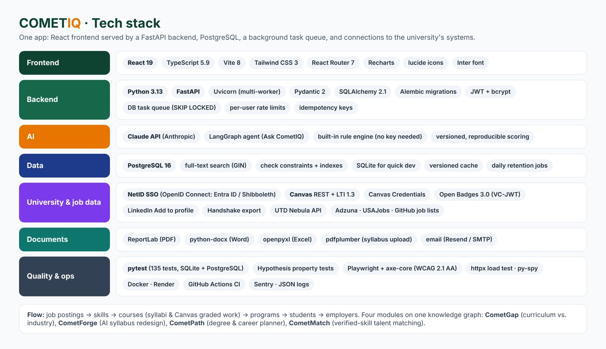

## What was built

| Area | Highlights |
|---|---|
| **Gap analysis** | Evidence for every skill, documented job samples, faculty review with rationale, versioned and reproducible scores, and semester comparison that splits each change into course revision, demand change and method update. |
| **Curriculum** | Pull-request-style proposals with a change-request form, the AACSB I/P/M curriculum map, the dean's scorecard, the syllabus copilot and the program simulator. |
| **Students and employers** | Degree plans, an evidence portal, faculty-verified badges, skill stacks, sponsored projects and talent search. |
| **AI** | Claude for analysis and drafting; Ask CometIQ (LangGraph) answers with citations; everything also works without an API key. |
| **University systems** | NetID single sign-on, Canvas import of syllabi, assignments and rubrics, CometIQ inside Canvas (LTI 1.3), badges sent to Canvas Credentials, Open Badges 3.0 plus LinkedIn, and Handshake postings. |
| **Accreditation** | AACSB assurance-of-learning report: competency goals, direct measures from graded work, results and closing the loop, exported to Word or PDF. |
| **Backend quality** | PostgreSQL with constraints, indexes and full-text search; safe concurrent writes; one error format; rate limits; daily data retention. |
| **Trust** | Privacy controls (consent, data export, deletion), WCAG 2.1 AA accessibility, monitoring, and 135 tests on SQLite and PostgreSQL. |

**Performance:** about 104 requests per second with no errors (5.8× faster than before), and p95 latency of 0.5 s with 20 concurrent users. See [LOAD-TEST.md](../performance/LOAD-TEST.md).

## Screens

### Faculty: CometGap and CometForge

| Gap report | Faculty review with evidence |
|---|---|
| 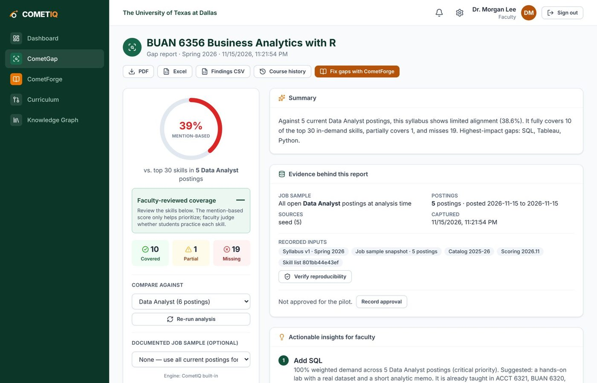 | 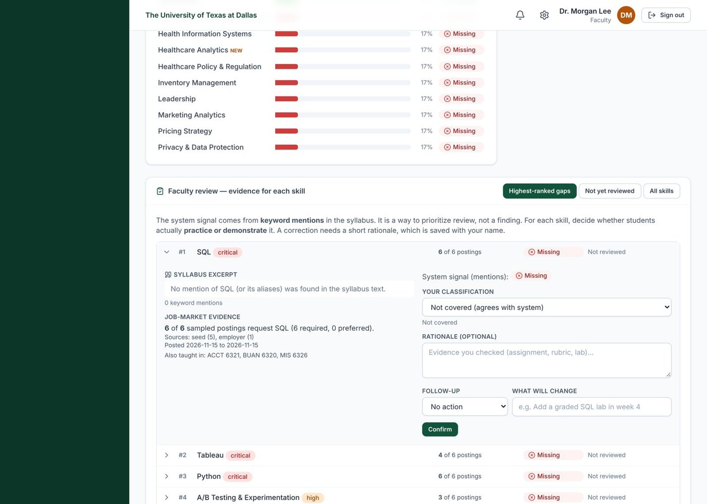 |

| Semester comparison | CometForge syllabus editor |
|---|---|
| 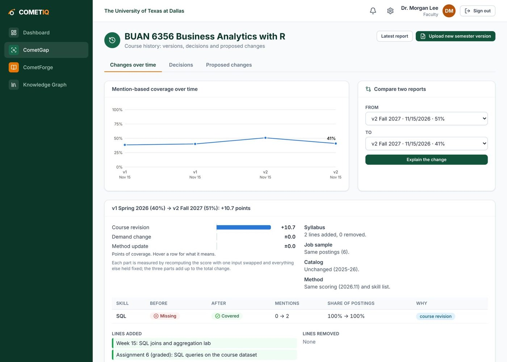 | 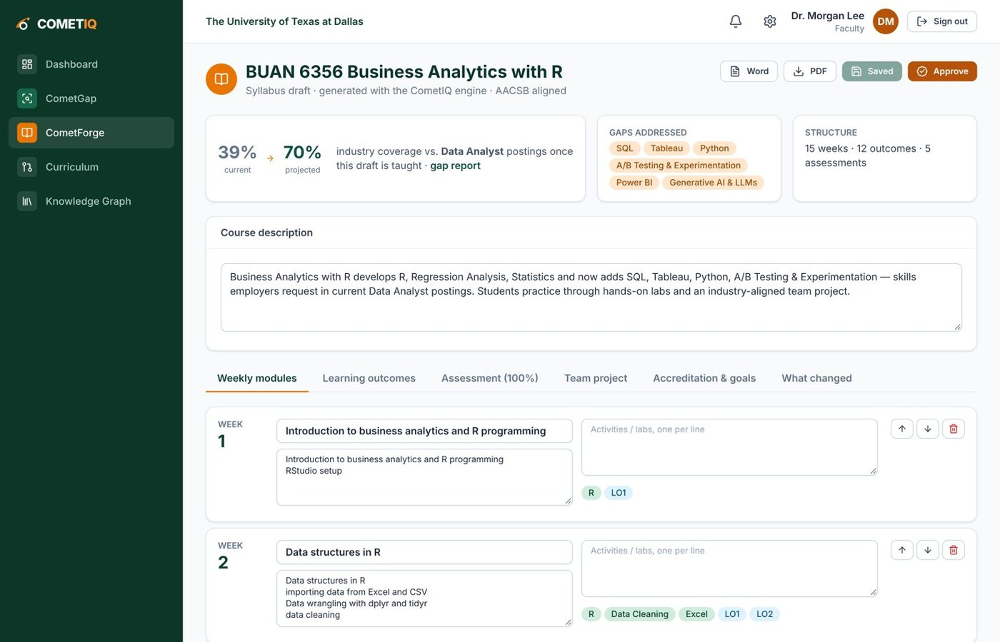 |

### Students and employers: CometPath and CometMatch

| Degree plan | Best-fit jobs |
|---|---|
| 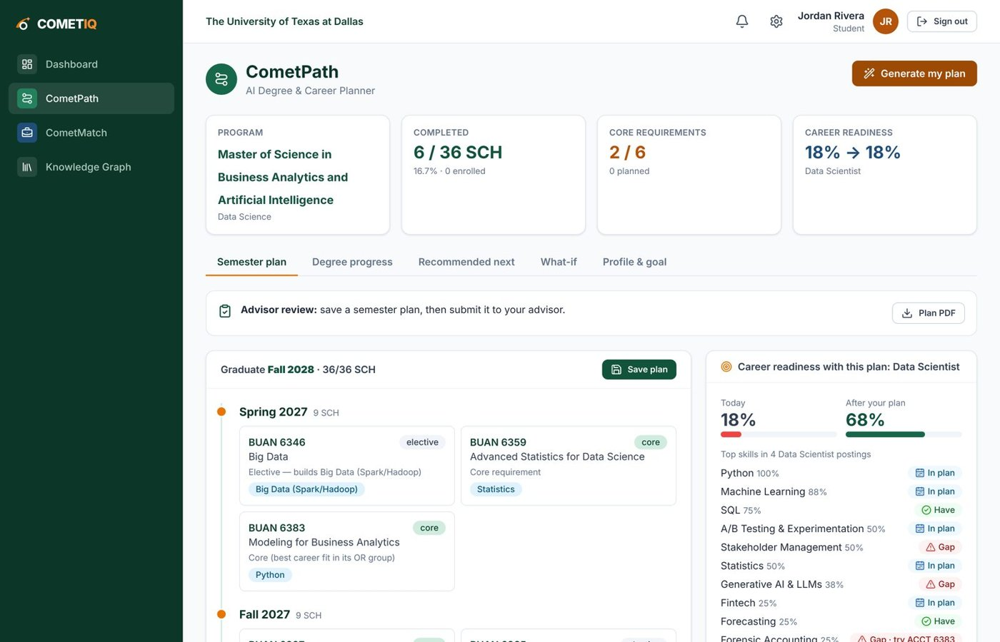 | 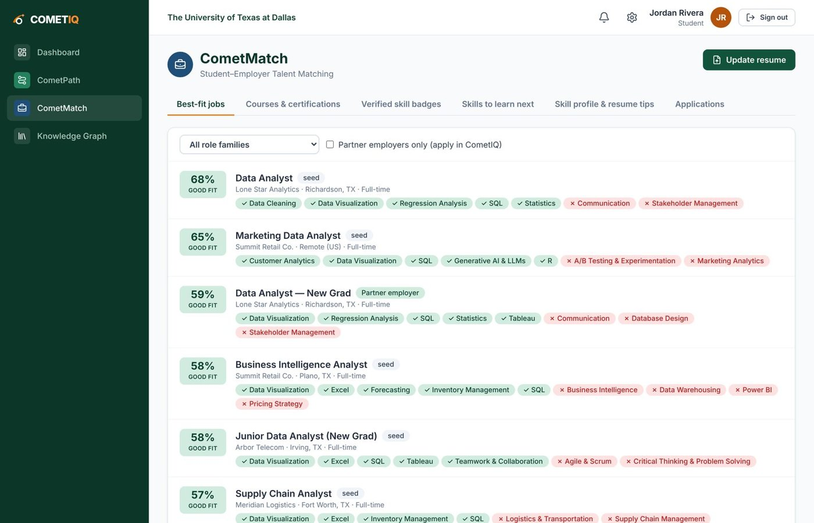 |

### Leadership

| Knowledge graph | Dean's program scorecard |
|---|---|
| 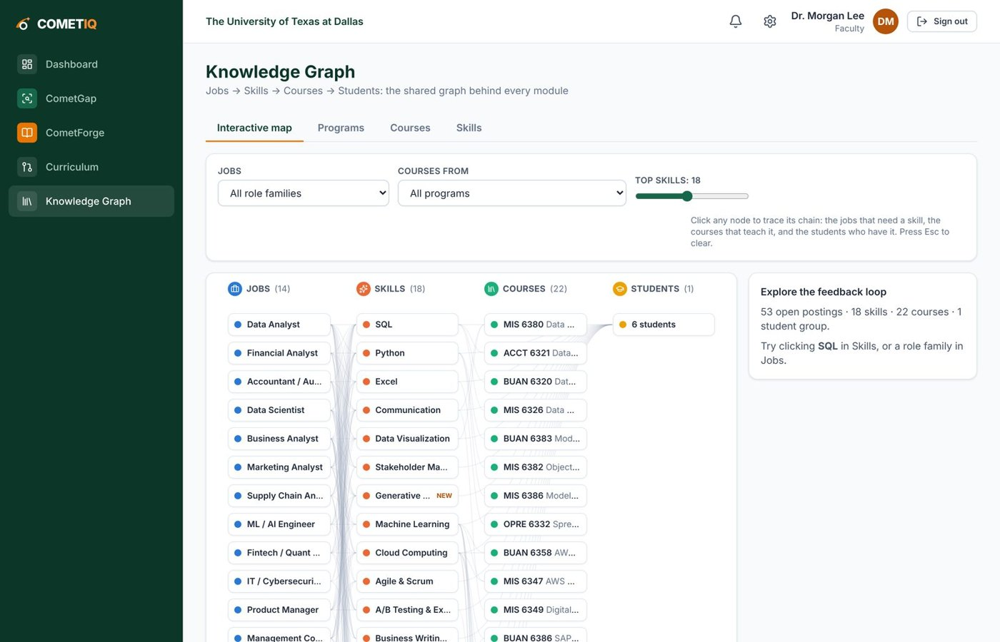 | 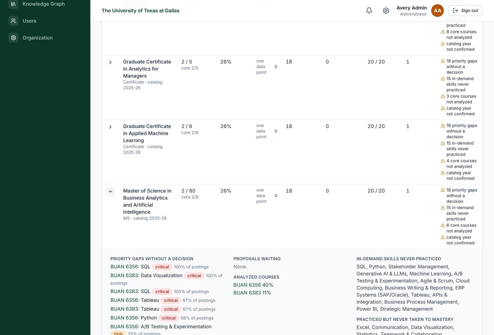 |

| Ask CometIQ | AACSB assurance-of-learning report |
|---|---|
| 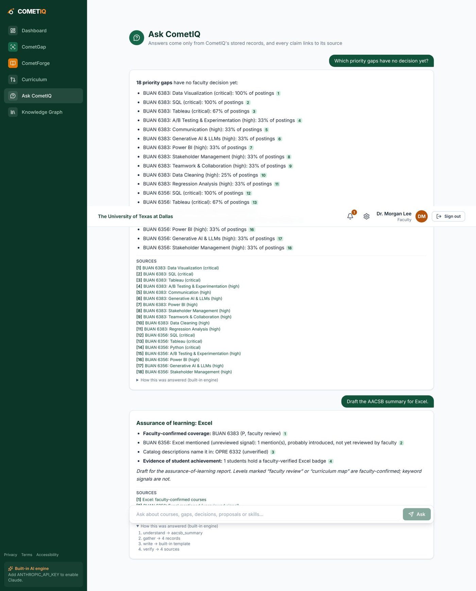 | 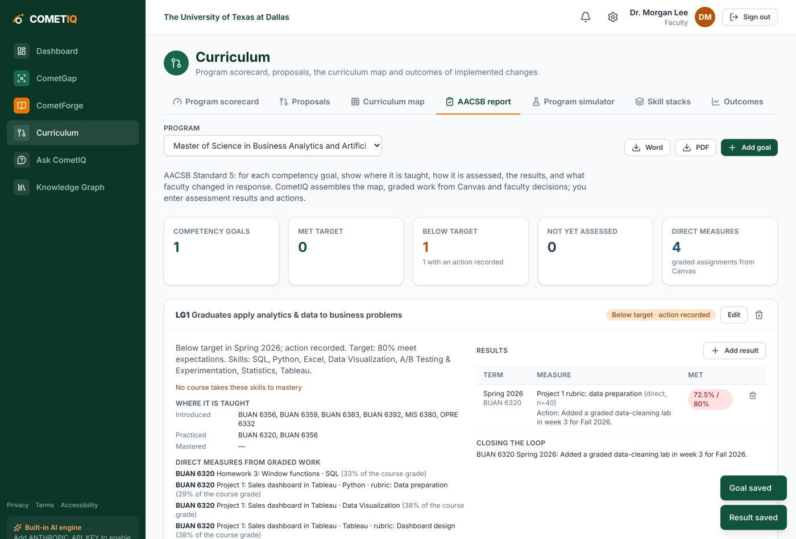 |

### University systems

| Sign in with UTD NetID | Import from Canvas |
|---|---|
| 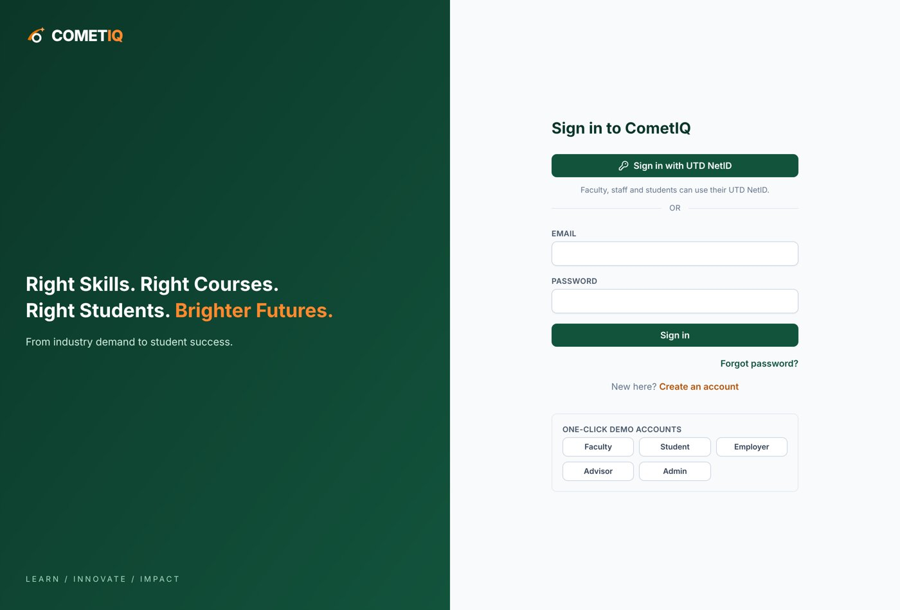 | 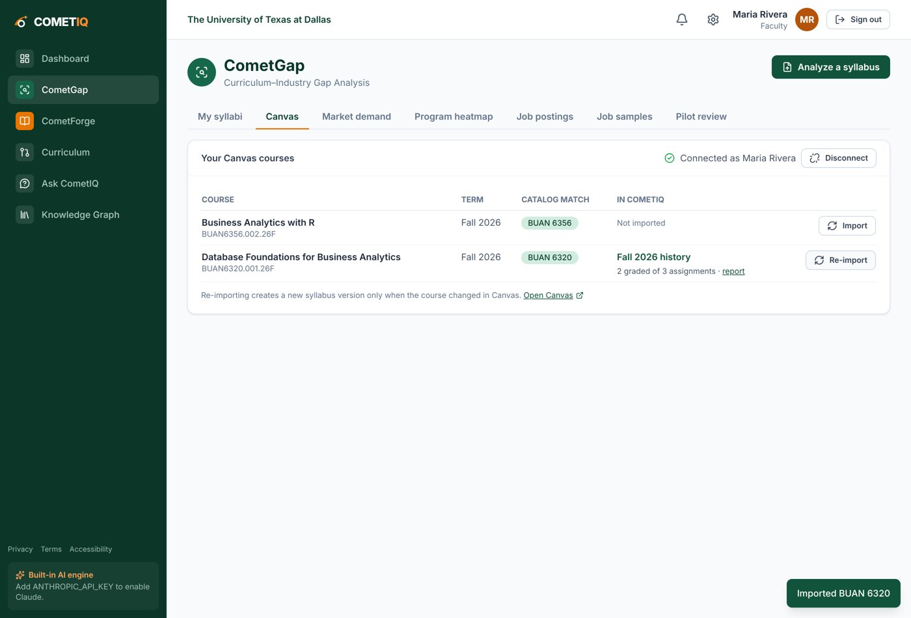 |

**CometIQ inside a Canvas course** (LTI 1.3):

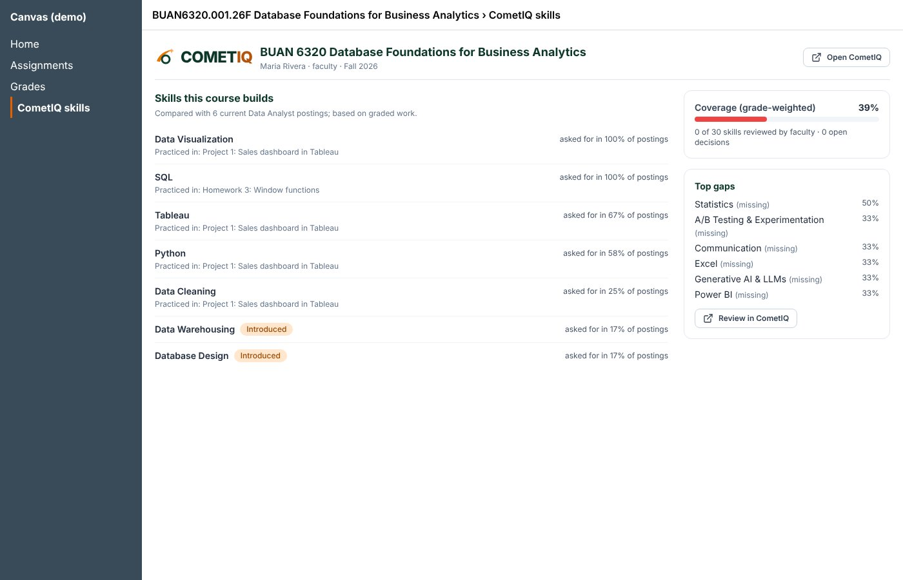

## Run it

```bash
./run.sh            # PostgreSQL via Docker (SQLite if Docker is missing)
```

Open http://localhost:8000. The demo accounts (faculty, student, employer, advisor and admin @cometiq.app) all use the password `CometIQ2026!`.

## More detail

| Document | Covers |
|---|---|
| [Project overview](../overview/CometIQ-Project-Overview.md) | The full write-up |
| [INTEGRATIONS.md](../INTEGRATIONS.md) | University systems setup |
| [AACSB-REPORT.md](../AACSB-REPORT.md) | The accreditation report |
| [DEPLOY.md](../../DEPLOY.md) | Hosting |
